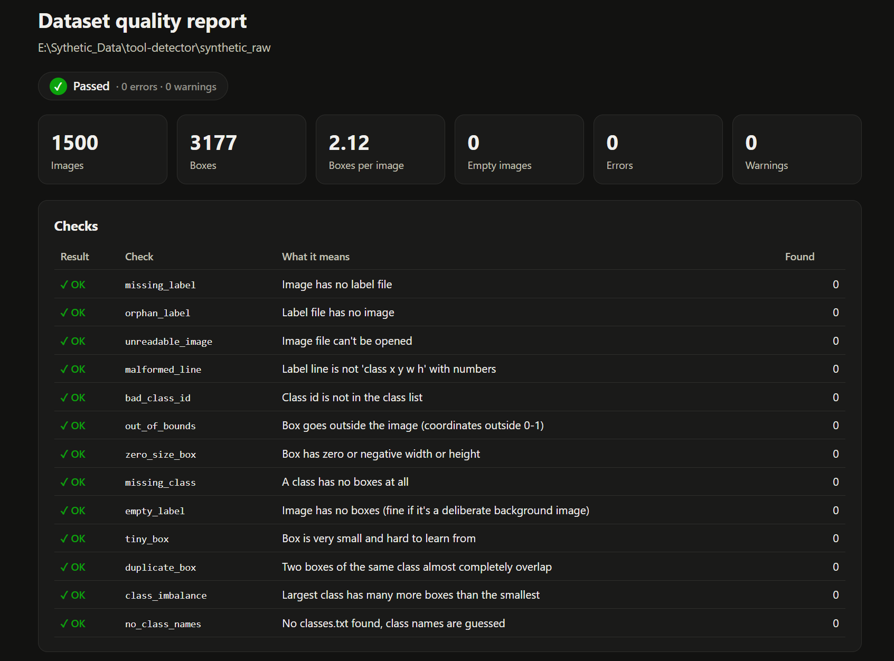

# SynthPipe

**Config file to labeled synthetic dataset, in one command.**

SynthPipe reads a YAML config, runs a Blender generator in the background and writes a YOLO dataset. ...

The first generator is ToolVision, a hand-tool dataset ...

> Status: v0.2: generate + validate. Auto-labeling and Hugging Face publishing are coming next.

## Example report

Every run ends with a quality report like this one, made from the 1,500-image ToolVision dataset (3,177 boxes, all checks passed):

[](https://moin77.github.io/synthpipe/example_report.html)

**[Open the full interactive report →](https://moin77.github.io/synthpipe/example_report.html)**

## Install

Needs Python 3.9+ and Blender 4.5.

```bash
git clone https://github.com/moin77/synthpipe
cd synthpipe
pip install -e .            # adds the `synthpipe` command
pip install -e .[dev]       # optional: tests + image comparison
```

## Use

1. Copy `configs/tools.yaml` and edit the paths (`blender.exe`, `blend_file`, asset folders, `output.dir`).
2. Check it without rendering:
   ```bash
   synthpipe generate -c configs/tools.yaml --dry-run
   synthpipe show-config -c configs/tools.yaml     # full config with defaults filled in
   ```
3. Quick test, then the full run:
   ```bash
   synthpipe generate -c configs/tools.yaml --count 20 --out runs/test
   synthpipe generate -c configs/tools.yaml
   ```

Output:

```
output.dir/
├── images/synth_00000.jpg ...
├── labels/synth_00000.txt ...   # YOLO: class x_center y_center width height (0-1)
├── classes.txt
├── run_config.json              # the full config the generator used
├── metadata.json                # seed, versions, class counts, config hash, rerun command
└── blender.log                  # full Blender output
```

If a run fails, the folder gets a `RUN_FAILED.txt` with the reason, so a broken dataset is never mistaken for a good one.

## What the config controls

| Section | What it sets |
|---|---|
| `seed`, `count`, `start` | Master seed, number of images, first index |
| `classes`, `objects` | Class names and the Blender objects that belong to them |
| `render` | Resolution, Cycles samples, lens |
| `randomization` | Tools per image, scatter, scale, flips, camera distance and angle, HDRI strength, spotlight chance, exposure, floor textures |

Typos and impossible values are caught before Blender starts:

```
ERROR: Config problems:
  - randomization.cam_distance_m: min (0.9) is bigger than max (0.3)
  - randomization.flip_chance: must be between 0 and 1, got 1.5
```

## Reproducibility

Each image gets its own random generator, seeded from the master seed and the image index, so image 734 comes out the same every time.

```bash
synthpipe generate -c configs/tools.yaml --count 5 --out runs/a
synthpipe generate -c configs/tools.yaml --count 5 --out runs/b
synthpipe compare runs/a runs/b
```

Labels must match byte for byte. Images are compared by hash, then by mean pixel difference (GPU denoising can change a few pixels between runs; use `--tolerance` to allow that).

`metadata.json` stores a SHA-256 of the settings that affect the output (not the machine paths), so two datasets with the same hash were made with the same settings.

## Tests

```bash
pytest
```

The tests use a fake Blender, so they run in seconds without rendering.

## License

MIT for the code. Check the license of every asset you render with before publishing a dataset.
