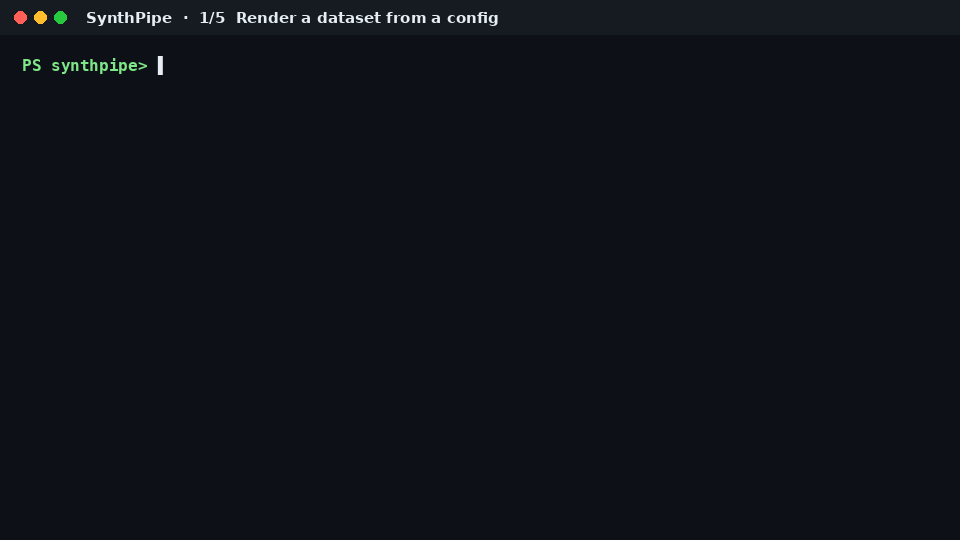

# SynthPipe

[](https://github.com/moin77/synthpipe/actions/workflows/tests.yml)

**Config file to labeled synthetic dataset, in one command.**



*The demo replays real outputs from the ToolVision runs: 1,500 rendered images, 106 real photos reviewed in CVAT, and the published Hugging Face dataset.*

SynthPipe reads a YAML config, runs a Blender generator in the background and writes a YOLO dataset. Every run saves the exact settings, seed and versions next to the dataset, so the same config and seed rebuild it again.

```bash
synthpipe generate --config configs/tools.yaml
```

The first generator is [ToolVision](https://github.com/moin77/toolvision), a hand-tool dataset (wrench, screwdriver, hammer, pliers) rendered in Blender Cycles.

> **Status:** v0.5. Generate, validate, auto-label, CVAT review and Hugging Face publishing all work, with tests running in CI. Next: v1.0.

## Example report

Every run ends with a quality report like this one, made from the 1,500-image ToolVision dataset (3,177 boxes, all checks passed):

[](https://moin77.github.io/synthpipe/quality_report.html)

**[Open the full interactive report →](https://moin77.github.io/synthpipe/quality_report.html)**

Published with `synthpipe publish`: [moindedroper/toolvision-synthetic](https://huggingface.co/datasets/moindedroper/toolvision-synthetic) on Hugging Face, with an auto-generated dataset card.

## Install

Needs Python 3.10+ and Blender 4.5.

```bash
git clone https://github.com/moin77/synthpipe
cd synthpipe
pip install -e .            # adds the `synthpipe` command
pip install -e .[dev]       # optional: tests + image comparison
```

## Use

1. Copy `configs/tools.yaml` and edit the paths (`blender.exe`, `blend_file`, asset folders, `output.dir`).
2. Check it without rendering:
   ```bash
   synthpipe generate -c configs/tools.yaml --dry-run
   synthpipe show-config -c configs/tools.yaml     # full config with defaults filled in
   ```
3. Quick test, then the full run:
   ```bash
   synthpipe generate -c configs/tools.yaml --count 20 --out runs/test
   synthpipe generate -c configs/tools.yaml
   synthpipe generate -c configs/tools.yaml --no-validate   # skip the checks
   ```

Output:

```
output.dir/
├── images/synth_00000.jpg ...
├── labels/synth_00000.txt ...   # YOLO: class x_center y_center width height (0-1)
├── classes.txt
├── run_config.json              # the full config the generator used
├── metadata.json                # seed, versions, class counts, config hash, rerun command
├── validation.json              # every check result and issue
├── quality_report.html          # visual report: charts, checks, sample images with boxes
└── blender.log                  # full Blender output
```

If a run fails, the folder gets a `RUN_FAILED.txt` with the reason, so a broken dataset is never mistaken for a good one.

## Validation and the quality report

Every `generate` run checks the new dataset and writes `quality_report.html`. You can also check any YOLO dataset, including real hand-labeled data:

```bash
synthpipe validate path/to/dataset                 # needs images/ and labels/ (train/val subfolders are fine)
synthpipe validate path/to/dataset --classes wrench,screwdriver,hammer,pliers
synthpipe validate path/to/dataset --strict        # warnings also fail (for CI)
```

| Errors (dataset is broken) | Warnings (worth a look) |
|---|---|
| Image without a label file, label without an image | Image with no boxes |
| Image that can't be opened | Tiny boxes (default < 1% of the image) |
| Label line that isn't `class x y w h` | Two same-class boxes almost on top of each other |
| Class id not in the class list | Class imbalance (default > 3x) |
| Box outside the image, zero-size box | No `classes.txt` |
| A class with no boxes at all | |

The report shows boxes per class, boxes per image, box sizes, where boxes land in the frame (a hot spot means objects are always centred), and sample images with their boxes drawn, problem images first. It is one HTML file with no internet needed, so it can be sent to a client as-is.

Exit codes: `0` passed, `1` errors (or warnings with `--strict`).

## Auto-labeling (pre-label real images with your model)

A trained YOLO model draws the first boxes, so a person only corrects them instead of labeling from scratch:

```bash
pip install -e .[autolabel]     # adds ultralytics
synthpipe autolabel --model runs/.../weights/best.pt --images new_photos --out prelabeled
```

Output: a normal YOLO dataset (`images/`, `labels/`, `classes.txt`), plus

- `predictions.json`: every box with its confidence
- `review_queue.txt`: images to check first (no boxes found, or a box below `--review-conf`, default 0.5), emptiest and least confident first
- `quality_report.html`: the usual checks plus an auto-labeling section with the confidence spread

**How good are the pre-labels?** If human labels already exist for the same images, add `--compare-to` and SynthPipe counts the edits a reviewer would make:

```bash
synthpipe autolabel -m best.pt -i real_test/images -o prelabeled --compare-to real_test/labels
```

```
Human boxes: 178
  correct, keep as is : ...
  wrong class         : ...
  box too loose/tight : ...
  missed, must draw   : ...
  extra, must delete  : ...
```

Matching: each human box is paired with the best-overlapping predicted box. IoU ≥ 0.5 with the same class is correct; IoU ≥ 0.5 with another class is a wrong class; a weaker same-class overlap needs adjusting; unmatched boxes are missed (human) or extra (model).

Useful options: `--conf` (default 0.25), `--imgsz` (default 640), `--device 0` or `cpu`, `--overwrite`.

## Human review in CVAT

Pre-labels go to [CVAT](https://www.cvat.ai/) for a person to correct, then come back as a clean dataset with a record of every change. This is the human-in-the-loop workflow labeling teams use.

```bash
synthpipe cvat-export prelabeled --out cvat_task          # images.zip + annotations_yolo11.zip + steps
# ... review in CVAT, then Export task dataset -> YOLO 1.1 ...
synthpipe cvat-import task_yolo11.zip --task-dir cvat_task --out reviewed --minutes 25
```

- **Worst images first.** Images are renamed `0001_<name>.jpg`, `0002_...` from the review queue, so CVAT shows the images with no boxes or low-confidence boxes first.
- **Fast upload.** Images are shrunk to 1600 px on the long side (`--max-side 0` keeps the originals). YOLO boxes are relative, so they still fit; the final dataset gets the original full-size images back.
- **Safe class mapping.** Labels coming back from CVAT are matched by name, not position, so a different label order in the CVAT task can't swap classes.
- **What changed.** The import compares the model's boxes with the reviewed ones: kept, class changed, adjusted, drawn by the reviewer, deleted. With `--minutes` it reports seconds per image.

## Publish to Hugging Face

One command writes a dataset card and uploads the dataset:

```bash
pip install -e .[publish]        # adds huggingface_hub
hf auth login                    # once, with a token that has write access
synthpipe publish synthpipe_runs/toolvision_seed42 --repo your-name/toolvision-synthetic --dry-run   # check README.md first
synthpipe publish synthpipe_runs/toolvision_seed42 --repo your-name/toolvision-synthetic
```

The card is built from what SynthPipe already recorded, so nothing is typed twice:

- **At a glance:** image and box counts, classes with their share, resolutions, validation result
- **How it was made:** generator, Blender version, seed, every randomization range, the exact command to rebuild it and the config fingerprint (for real photos: the model, and what the human review changed)
- **Known limitations, found in the data:** class imbalance, objects bunched in the middle of the frame, empty images, any validation warnings, plus your own `--note` lines
- License, a citation entry, and a `data.yaml` so `yolo detect train data=data.yaml` works after download

Safety checks: datasets with validation errors are not uploaded (`--force` overrides), and real photos need `--confirm-rights` to confirm you may share them.

## What the config controls

| Section | What it sets |
|---|---|
| `seed`, `count`, `start` | Master seed, number of images, first index |
| `classes`, `objects` | Class names and the Blender objects that belong to them |
| `render` | Resolution, Cycles samples, lens |
| `randomization` | Tools per image, scatter, scale, flips, camera distance and angle, HDRI strength, spotlight chance, exposure, floor textures |
| `validation` | Turn checks on/off, tiny-box, imbalance and duplicate limits, gallery size |

Typos and impossible values are caught before Blender starts:

```
ERROR: Config problems:
  - randomization.cam_distance_m: min (0.9) is bigger than max (0.3)
  - randomization.flip_chance: must be between 0 and 1, got 1.5
```

## Reproducibility

Each image gets its own random generator, seeded from the master seed and the image index, so image 734 comes out the same every time.

```bash
synthpipe generate -c configs/tools.yaml --count 5 --out runs/a
synthpipe generate -c configs/tools.yaml --count 5 --out runs/b
synthpipe compare runs/a runs/b
```

Labels must match byte for byte. Images are compared by hash, then by mean pixel difference (GPU denoising can change a few pixels between runs; use `--tolerance` to allow that).

`metadata.json` stores a SHA-256 of the settings that affect the output (not the machine paths), so two datasets with the same hash were made with the same settings.

## Tests

```bash
pytest
```

41 tests, including one that runs the whole pipeline (generate → validate → auto-label → CVAT round-trip → publish). Blender, the YOLO model, CVAT and Hugging Face are replaced by small fakes, so the suite runs in seconds with no GPU or network. GitHub Actions runs it on Windows and Linux with Python 3.10, 3.12 and 3.13 on every push.

## License

MIT for the code. Check the license of every asset you render with before publishing a dataset.
